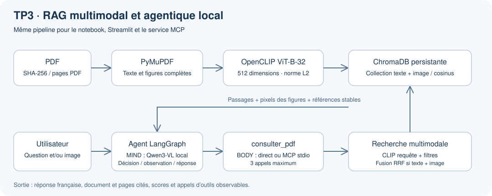
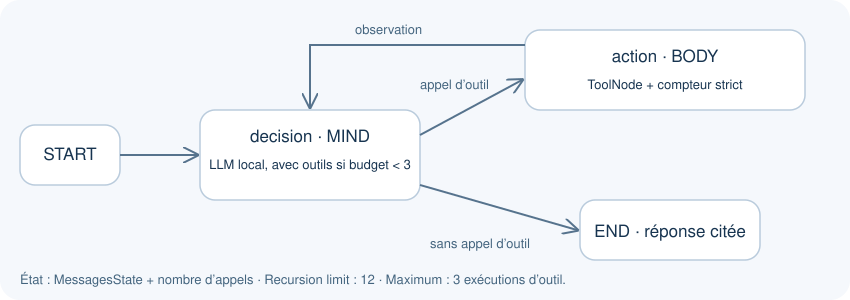

# TP3 — RAG multimodal et agentique

| Informations académiques | Détails |
|---|---|
| Nom et prénom | Hachoum Mouad |
| Filière | INTELLIGENCE ARTIFICIELLE & SCIENCES DES DONNÉES |
| Année universitaire | 2026-2027 |
| Module | IA Générative Multimodale |
| Enseignant | Pr. Mohamed Youssfi |

## Objectif et architecture

Interroger le texte et les figures d’un PDF avec un RAG local, puis laisser un
agent choisir ses recherches et produire une réponse sourcée en français.
Le notebook suit les sept étapes du professeur, complétées par Streamlit et MCP.

Le développement est terminé. Cette **édition publique** conserve le code,
les explications, les diagrammes originaux et les résultats numériques. Les
reproductions de figures, passages récupérés et réponses documentaires ont été
retirées des sorties et rapports. La copie locale complète est conservée ;
voir [PUBLICATION.md](PUBLICATION.md) et [le manifeste](publication.json).



1. **Extraction PyMuPDF** : texte complet et par page, images intégrées dédupliquées,
   rendu de figures composées ou vectorielles ; répertoire distinct par SHA-256 du PDF.
2. **OpenCLIP** : ViT-B-32, `laion2b_s34b_b79k`, 512 dimensions ; fenêtres de
   60 tokens, chevauchement de 10, normalisation L2, lots et `inference_mode()`.
3. **ChromaDB** : collection persistante commune texte/image, distance cosinus,
   embeddings explicites, identifiants déterministes et upserts. Un PDF modifié
   remplace sa version précédente sous le même alias après indexation réussie.
4. **Recherche** : texte→texte, texte→image, image→texte, image→image et recherche
   mixte. Texte + image utilisent RRF(60), au plus 48 candidats par entrée.
   Une demande explicite de « figure n » filtre ce numéro avant classement.
5. **RAG local** : passages et pixels des figures sont réellement transmis au VLM.
   Les sources sont traitées comme des données et les références sont contrôlées.
6. **Agent LangGraph** : `StateGraph`, `MessagesState`, `ToolNode`, transitions
   conditionnelles, trois appels maximum et limite de récursion 12. Une image
   enregistrée est liée aux outils côté application, même si le modèle omet son ID.
   Une relecture réelle par le modèle demande de couvrir tous les points et de
   vérifier les passages cités ; elle demande une recherche complémentaire sur
   le point le moins étayé lorsqu'un appel reste disponible.
   Le contexte du modèle regroupe au plus 12 preuves uniques, en donnant priorité
   aux recherches récentes ; les traces complètes restent enregistrées.
7. **Validation** : 15 cas annotés, tests unitaires et intégration réelle.



Le **MIND** utilise `qwen3-vl:4b-instruct-q4_K_M` dans Ollama ; le **BODY** est
`consulter_pdf`. Ce modèle de 4B, déjà présent localement, a passé des tests réels
de vision et de tool calling. Aucun autre LLM n’a été téléchargé et aucune API
payante n’a été utilisée. Le contexte est limité à 6 144 tokens. Sur le GPU 6 Go,
Ollama peut répartir le modèle entre GPU et CPU. Le serveur MCP utilise CLIP sur
CPU par défaut pour éviter une seconde copie GPU ; l’indexation principale utilise CUDA.

## Résultats de l’exécution locale

| Vérification | Résultat réel |
|---|---|
| Corpus | 11 pages PDF ; 3 images intégrées extraites |
| Index OpenCLIP / ChromaDB | 171 chunks + 2 figures complètes = 173 éléments |
| Recherche annotée | 13/13 cas avec une page/figure pertinente retrouvée |
| Agent local | 15/15 scénarios exécutés ; budget ≤ 3 appels : True |
| Contrôles de motifs dans les réponses | 11/15 ; indicateur partiel, pas une accuracy sémantique |
| Références générées inconnues après contrôle | 0 |
| Image de requête effectivement utilisée | True |
| Streamlit / MCP | AppTest et HTTP : succes ; découverte, outil et agent MCP : succes |
| Notebook | 11 cellules Python exécutées depuis un noyau neuf ; 0 erreur |
| Tests automatisés | 31 tests réussis, unitaires et intégration |

Temps moyen de l’agent : **12.45 s** sur cette machine.
Le [rapport public](resultats_tp3.json) conserve les métriques, scores, durées,
identifiants et pages des exécutions réelles. Les passages, réponses documentaires
et requêtes générées sont masqués ; les traces intégrales restent dans la copie locale.

Les figures 1 et 2 sont retrouvées au premier rang par leurs requêtes textuelles
anglaises annotées. Le test image identique vérifie le fonctionnement et ne mesure
pas la généralisation. Les autres cas utilisent Hit@6 **par page** : retrouver une
page pertinente ne signifie pas que tous les chunks ou toutes les réponses sont corrects.
Les contrôles de motifs et de citations ne constituent pas une évaluation humaine
exhaustive de la fidélité scientifique. Les cas non conformes restent visibles dans le rapport.

La référence initiale est conservée : **11/15**
contrôles lexicaux, contre **11/15** après modification,
avec les mêmes critères. Les quatre cas signalés ont été relancés avant les onze
autres. La [relecture sémantique](evaluations/relecture_semantique.json) distingue
les omissions, les formulations correctes sans le mot attendu et les affirmations
insuffisamment étayées. Elle est qualitative et assistée par Codex, sans prétendre
à une notation humaine indépendante. Voir [le protocole](evaluations/README.md).

L'encodage positionnel explicite maintenant les sinus et cosinus. La contribution
reste incomplète et les valeurs Base demandées ne sont pas toutes retrouvées.
Le masquage est expliqué correctement sur le principe, mais sa citation reste
insuffisante. Le cas image→texte emploie « encodage/décodage », qui ne satisfait
pas les motifs « encodeur/décodeur » ; ses détails restent partiellement étayés.
Le score global inchangé ne prouve donc pas une amélioration générale de fidélité.

Le corpus fourni comporte 11 pages et annonce **41,0 BLEU** pour anglais-français.
Les annotations correspondent à son empreinte SHA-256 dans `tests/cases.json`.
Elles ne doivent pas être appliquées sans vérification à une autre édition de l’article.

## Installation avec UV

Pré-requis : [UV](https://docs.astral.sh/uv/), Ollama local et, pour CUDA,
un pilote NVIDIA compatible avec les roues PyTorch CUDA 12.8.
Depuis la racine du dépôt, dans PowerShell :

```powershell
cd TP3
uv sync --locked
ollama list
```

Le projet possède son propre Python 3.11 et son environnement `.venv` ; les autres
TPs ne sont pas modifiés. Torch 2.9.1 et torchvision 0.24.1 sont verrouillés.
Si le modèle LLM est absent, télécharger une seule fois le
[modèle quantifié utilisé](https://ollama.com/library/qwen3-vl:4b-instruct-q4_K_M) :

```powershell
ollama pull qwen3-vl:4b-instruct-q4_K_M
```

Vérifier le modèle réellement installé avant les expériences :

```powershell
uv run tp3 probe
```

Cette commande teste les couleurs d’une image et l’appel réel d’un outil d’addition.
Les poids OpenCLIP imposés sont téléchargés au premier chargement dans `data/models`,
puis réutilisés. Aucun entraînement n’est nécessaire.

## Préparation du PDF et indexation

Pour utiliser le PDF fourni, remplacer le chemin relatif par celui de sa copie locale :

```powershell
uv run tp3 prepare --pdf ./supports/attention_is_all_you_need.pdf
uv run tp3 index
```

Une commande reproductible de téléchargement est également proposée :

```powershell
uv run tp3 prepare --download
uv run tp3 index
```

Le téléchargement fixe `https://arxiv.org/pdf/1706.03762v1` et réutilise un PDF déjà
présent. Le fichier arXiv peut différer du corpus fourni : le pipeline fonctionne,
mais la batterie annotée refuse une empreinte différente plutôt que de fabriquer
une ground truth. Voir [SOURCES.md](SOURCES.md).

Une réindexation explicite du même PDF réutilise les vecteurs existants :

```powershell
uv run tp3 index --force
uv run tp3 search "scaled dot product attention" --type texte --k 6
```

## Notebook et tests

```powershell
uv run python tools/verify_streamlit.py
uv run python tools/execute_notebook.py
uv run python -m pytest -q -m "not integration"
uv run python -m pytest -q -m integration
```

Le lanceur choisit le Python de TP3, crée un noyau neuf, vérifie la syntaxe et
enregistre le notebook avec ses sorties. Il génère `verification_execution.json`,
une preuve locale ignorée par Git. `uv run tp3 validate` relance uniquement le
protocole réel des 15 cas et MCP ; cette commande refait les inférences du LLM.
Les tests unitaires du stockage utilisent parfois des vecteurs synthétiques,
explicitement séparés des tests réels OpenCLIP/Ollama et des métriques publiées.

Pour une exécution interactive, sélectionner le noyau Python de `TP3/.venv` dans
VS Code, puis **Restart Kernel and Run All Cells**, avec TP3 comme répertoire courant.
Le notebook déjà exécuté permet de consulter les résultats sans refaire les inférences.

## Interface Streamlit

```powershell
uv run streamlit run app.py --server.address=127.0.0.1 --server.port=8503
```

L’interface propose l’import d’un PDF, l’indexation ou la réutilisation de son index,
un chat, une image de requête facultative, les filtres, les scores, les sources et
les appels d’outils. Elle utilise les modules du notebook. Un thème clair est défini
dans `.streamlit/config.toml`. Les imports sont limités à 30 Mo pour un PDF et
15 Mo pour une image dans le pipeline. Le bouton **Rechercher avec l’image seule**
ne requiert pas de texte et n'ajoute aucun texte à l'embedding de recherche.

AppTest a importé les vrais octets du PDF et d'une image et testé l'indexation,
la sélection, les recherches hybrides et image seule, les sources et les traces,
avec OpenCLIP et Ollama réels. Les vecteurs du corpus restent identiques.
Le serveur répond HTTP 200. Le sélecteur natif et le transfert navigateur restent
**non validés** : suivre le [parcours manuel](docs/verification_manuelle.md).

## Serveur et client MCP

```powershell
uv run python mcp_client.py "Explique la figure 2 du document."
```

Le client démarre automatiquement `mcp_server.py` dans un processus séparé, découvre
`consulter_pdf`, puis exécute l’agent via stdio. Le serveur peut aussi être lancé
directement par un client MCP compatible :

```powershell
uv run python mcp_server.py
```

Le serveur seul attend les messages du protocole sur stdin ; stdout est réservé
à MCP. Il ne faut pas lancer ce serveur seul dans l’espoir d’obtenir un chat texte.
Les images de requête sont autorisées par leur identifiant enregistré, et les
sources visuelles sont chargées uniquement depuis le stockage documentaire.

## Organisation et configuration

- [Notebook exécuté](TP3_RAG_Multimodal_Agentique.ipynb)
- [Interface](app.py), [serveur MCP](mcp_server.py), [client MCP](mcp_client.py)
- [Composants partagés](src/tp3rag/), [tests et annotations](tests/), [outils d’exécution](tools/)
- [Configuration UV](pyproject.toml), [verrou](uv.lock), [.python-version](.python-version)
- [Résultats détaillés](resultats_tp3.json), [sources académiques et techniques](SOURCES.md)

Variables facultatives : `TP3_LLM_MODEL` (nom Ollama), `TP3_OLLAMA_URL` (serveur
local uniquement), `TP3_DATA_DIR` (stockage local), `TP3_CLIP_DEVICE` (`auto`, `cpu`
ou `cuda`). Aucun secret ni fichier `.env` n’est nécessaire. `data/` contient PDF,
extractions, requêtes, poids et ChromaDB ; il est exclu du suivi Git, comme `.venv`,
les supports originaux, caches et rapports de vérification locaux.

## Limites

Le corpus et le jeu de tests sont petits. CLIP est surtout anglophone et n’est
pas un encodeur spécialisé de textes scientifiques. Le découpage peut couper une
phrase ; les équations extraites peuvent perdre leur mise en page. Le VLM 4B
peut donner une réponse incomplète ou incorrecte malgré des références existantes.
La correction du format des citations ne garantit pas le bien-fondé des affirmations.
Une réponse doit donc être vérifiée dans les pages indiquées. L’interface conserve
l’historique de session, sans mémoire conversationnelle persistante côté agent.

Le support officiel du **Pr. Mohamed Youssfi** et l’article de **Vaswani et al.**
sont crédités dans [SOURCES.md](SOURCES.md). Intégration, rédaction et validation
préparées pour Hachoum Mouad avec l’assistance de Codex.
Les reproductions dont les droits ne sont pas établis sont exclues de l'édition
publique ; les références bibliographiques et les limites scientifiques sont conservées.
